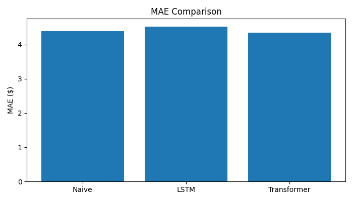
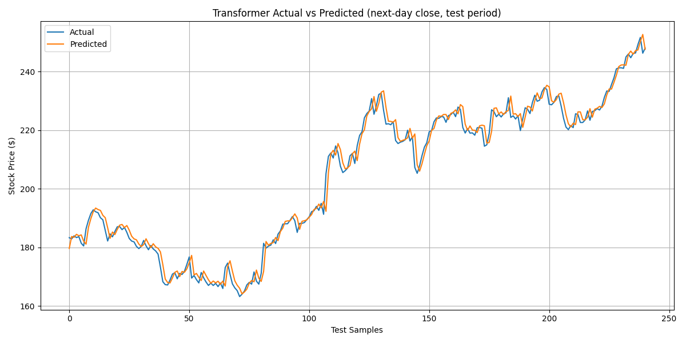

# 📈 Multi-Step Stock Price Forecasting: LSTM vs Transformer

Predict Apple's (AAPL) closing price for each of the next **7 trading days** with two deep learning architectures, and test them honestly against the baseline every price forecast has to beat: *"the price stays where it is"*.

---

## 📊 Results

Test period: the final 10% of 2015–2024 (roughly Jan–Dec 2024, 241 forecast windows), never seen during training or model selection.

| Model | MAE ($) | RMSE ($) | MAPE | Directional accuracy |
|---|---|---|---|---|
| Naive baseline (last close) | 4.39 | 5.85 | 2.14% | – (makes no up/down call) |
| LSTM | 4.53 | 6.15 | 2.23% | 56.4% |
| **Transformer** | **4.35** | **5.75** | **2.14%** | **58.6%** |

*Directional accuracy = how often the model correctly says whether the price on each of the next 7 days will be above or below today's close.*

**Takeaways**

- Daily stock prices are close to a random walk, so "tomorrow ≈ today" is a very strong baseline. The Transformer edges past it on price error and gets the **direction right 58.6% of the time**, which is where the real signal is.
- The LSTM starts overfitting after about 10 epochs (validation loss rises while training loss keeps falling); the best checkpoint is picked by validation loss.




---

## 🔍 What I fixed along the way (and why it matters)

The first version predicted raw **price levels** and scored far worse than the naive baseline (LSTM MAE $10.77, directional accuracy 46%, worse than a coin flip). Two problems caused that:

1. **Non-stationary target.** Test-period prices ($160–$257) lie above anything seen in training (max ≈ $178). A model trained on price levels has to extrapolate, which neural networks do badly. **Fix:** predict the next 7 **returns** relative to the last close and convert them back to prices; the input indicators are also expressed as scale-free ratios (e.g. EMA gap to price, Bollinger-band position, normalised MACD).
2. **Look-ahead leakage.** Scalers were fitted on the whole dataset, including the test period. **Fix:** scalers are now fitted on training windows only.

A naive baseline and a returns-based directional metric were added so every number has a reference point.

---

## ⚙️ How It Works

1. **Data** — daily OHLCV from Yahoo Finance (`yfinance`), cached to `data/` so runs are reproducible offline.
2. **Features** — technical indicators (EMA, MACD, RSI, Bollinger Bands, volume ratio, returns, volatility) converted to scale-free form.
3. **Windows** — 60 days of features → next 7 daily returns.
4. **Split** — chronological 80 / 10 / 10 (train / validation / test), no shuffling.
5. **Models** — stacked LSTM and Transformer encoder (PyTorch), MSE loss, Adam, `ReduceLROnPlateau`, gradient clipping, best checkpoint by validation loss.
6. **Evaluation** — RMSE, MAE, MAPE and directional accuracy in dollars on the test period, compared with the naive baseline.

---

## 🗂️ Project Structure

```
stock-forecasting/
├── data/                    # Cached price data (auto-created)
├── models/
│   ├── lstm_model.py        # Stacked LSTM
│   └── transformer_model.py # Transformer encoder
├── utils/
│   ├── preprocess.py        # Chronological split helpers
│   ├── indicators.py        # Technical indicators + scale-free features
│   └── metrics.py           # RMSE, MAE, MAPE, directional accuracy
├── outputs/                 # Checkpoints, evaluation.csv, predictions.csv, charts
├── train.py                 # Training & evaluation
└── requirements.txt
```

---

## 🚀 Usage

```bash
pip install -r requirements.txt

python train.py --model both          # default
python train.py --model lstm
python train.py --model transformer
```

## 🔧 Key Config (in train.py)

| Parameter | Default | Description |
|---|---|---|
| `TICKER` | `AAPL` | Stock symbol |
| `LOOKBACK` | `60` | Past days used as input |
| `HORIZON` | `7` | Future days to predict |
| `EPOCHS` | `50` | Training epochs |
| `LR` | `1e-3` | Learning rate |

---

## 💡 Extensions

- Swap `TICKER` to `^NSEI` for NIFTY 50
- Walk-forward (rolling-origin) evaluation across several years instead of one test period
- Add market context features (VIX, index returns) and early stopping for the LSTM
- Add a Streamlit dashboard for live inference

> ⚠️ Educational project — not financial advice.
